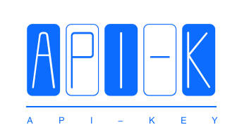

# 多平台大模型 API-KEY 集中管理工具

<div align="center">
	
	<p align="center">
    
    
    
    
    
    
    
    
    
    
	</p>
	<p>&nbsp;</p>
</div>

一个面向个人 / 小团队的桌面端「模型 API-KEY 统一管理与对话测试台」：集中维护多个模型供应商（OpenAI 兼容 / Anthropic 两种协议）、模型定价、API-KEY 额度与分配关系，内置对话测试页并自动统计 Token 消耗与费用。后端持有密钥，前端不接触第三方 Key；普通用户只能使用被分配给自己的 Key。

- 后端：Go + GoFrame v2 + gdb（默认 MySQL，可切回 SQLite 纯 Go 驱动）
- 前端：Vue3 + Vite + TypeScript + Element Plus + Pinia + Vue Router + axios
- 桌面壳：Electron（electron-builder 打包 Windows nsis / macOS dmg / Linux AppImage）

## 功能特性

| 模块 | 说明 |
|---|---|
| 供应商管理 | 名称、协议格式（OpenAI / Anthropic）、API 地址 base_url、平台网址、余额、最大并发数、超时时长、启停、备注 |
| 模型管理 | 所属供应商、缓存命中输入价、未命中输入价、输出价（元/百万 Token，两位小数）、上下文长度（列表按 M 展示）、是否支持思考模式、是否支持多模态、启停 |
| API-KEY 管理 | 名称、所属供应商、Key 明文（列表掩码回显）、有效日期、最大限额 / 已用额度进度、启停；一个供应商可挂多个 Key；可批量分配给用户 |
| 用户与权限 | admin 管理员（全部管理 + 全局统计 + 查看全部会话）；user 普通用户（仅使用被分配且可用的 Key、仅看本人会话与个人统计）；JWT 登录；公开自助注册默认开通（注册即普通用户，`app.allow_register` 可关闭） |
| 对话测试 | 按用户可用 Key 与模型发起多轮对话；支持 SSE 流式渲染；记录每条消息 Token（含缓存命中 Token）与折算费用；Key 额度自动累计 |
| 对话增强 | 思考过程（reasoning）独立 SSE 事件、气泡内可折叠展示；assistant 消息头部显示「供应商 · 模型」；新建 Key 自动分配给创建者；上游非 SSE 时后端切片模拟逐字流式（约 20ms 片间隔、Markdown 结构单元不拆碎、受供应商超时约束） |
| 消息渲染 | assistant 正文 Markdown 渲染（marked 解析 + DOMPurify 消毒，杜绝未过滤注入；代码块暗色等宽横向滚动；本轮不引入语法高亮依赖）；assistant 气泡占满消息区宽度，user 气泡靠右约 60% 蓝底；user 消息与思考折叠区保持纯文本 |
| 统计概览 | 全局 / 个人维度的供应商数、模型数、Key 数、会话数、今日 Token、今日费用、累计费用 |
| 仪表盘图表 | 调用 Top 榜单（模型 / 供应商 × 调用次数 / Token / 费用切换）、供应商调用占比环形图、7/30 天用量趋势双轴图（柱=费用、线=Token）、Token 用量构成环形图；空数据空态兜底；admin 全局、user 本人口径 |
| 双协议转发 | OpenAI 兼容 `POST {base_url}/chat/completions`（Bearer）与 Anthropic `POST {base_url}/v1/messages`（x-api-key + anthropic-version），协议适配独立成包 |

## 目录结构

```
.
├── backend/                    # GoFrame v2 后端（模块名 apikey-manager）
│   ├── main.go                 # 入口；空白导入 sqlite 驱动，mysql 驱动注释预留
│   ├── manifest/config/config.yaml
│   └── internal/
│       ├── cmd/                # 路由装配与启动命令
│       ├── controller/         # 接口控制器（auth/provider/model/key/user/chat/stats）
│       ├── service/            # 业务接口定义
│       ├── logic/              # 业务实现（含 scan 行扫描辅助）
│       ├── model/               # 实体实体 entity.go + DTO dto.go
│       ├── middleware/         # JWT 鉴权 + 管理员守卫 + 上下文用户
│       ├── adapter/            # 协议公共抽象；openai/ 与 anthropic/ 两套适配
│       ├── initialize/          # SQLite/MySQL 双方言 DDL 自动建表 + 种子数据
│       └── pkg/                # errs / response / jwtx / semaphore / util(掩码、截断)
├── web/                        # Vue3 + Electron 前端
│   ├── electron/               # 主进程 main.cjs + preload.cjs
│   ├── resources/             # 打包时 extraResources 后端二进制预留位
│   ├── src/
│   │   ├── api/                # 按模块拆分的接口封装（含类型）
│   │   ├── types/index.ts      # TS 类型（逐字段对齐后端契约）
│   │   ├── utils/request.ts    # axios 封装（Bearer 注入、统一解包与错误提示）
│   │   ├── store/              # Pinia 用户态（localStorage 持久化）
│   │   ├── router/             # 路由表 + 角色守卫
│   │   ├── layout/             # 侧边菜单 + 顶栏 + 修改密码弹窗
│   │   └── views/              # login/dashboard/providers/models/keys/users/chat
│   ├── vite.config.ts          # 5173 端口；/api 代理到 127.0.0.1:8090；outDir dist
│   └── package.json            # electron-builder 配置（win nsis / mac dmg / linux AppImage）
└── docs/api-contract.md         # 前后端冻结接口契约（表结构 + 端点 + SSE 格式）
```

## 环境要求

- Go 1.21+（开发机已在 Go 1.23 验证；切回 SQLite 时为纯 Go 驱动，无需 CGO / gcc）
- Node.js 18+（推荐 20/22）、npm
- MySQL 8.0+（当前默认数据库；本机 5.7 已验证。需先建空库、字符集 utf8mb4）

## 快速开始

> 开发期为「后端服务 + 前端 dev server」分别启动；Electron 仅在需要桌面窗口调试 / 打包时使用。

### 1. 启动后端

```bash
cd backend
go mod tidy
go run . 
# 默认监听 :8090；首次启动自动建表并写入内置管理员与示例数据
```

配置文件 `backend/manifest/config/config.yaml`：

| 配置项 | 说明 |
|---|---|
| server.address | 服务监听地址，默认 `:8090` |
| database.default.type | 驱动名：`mysql`（当前默认）或 `sqlite`（纯 Go 无 CGO） |
| database.default.host/port/name/user/pass/charset | MySQL 连接参数（默认 `127.0.0.1:3306`，库名 `apikey_manager`，utf8mb4；需先手动建空库） |
| sqlite 配置注释节 | 切回 SQLite 时取消注释、注释 mysql 节，并在 `main.go` 放开 sqlite 驱动空白导入 |
| jwt.secret / jwt.expire | JWT 签名密钥与有效期（秒，默认 7 天；生产请修改 secret） |
| default.username / password / displayName | 首次初始化内置管理员（admin / admin123），仅 users 表为空时写入，不覆盖已有账号 |

> 后端也可先编译再运行：`CGO_ENABLED=0 go build -o bin/api .`，然后 `./bin/api -c manifest/config/config.yaml`（兼容写法；框架原生写法为 `./bin/api --gf.gcfg.file=manifest/config/config.yaml`；不传参数时自动搜索 `manifest/config/config.yaml`）。

### 2. 启动前端开发服务

```bash
cd web
npm install
npm run dev:vite     # http://localhost:5173，/api 代理到 127.0.0.1:8090
```

浏览器打开终端提示地址，使用 `admin / admin123` 登录。TypeScript 类型检查：`npx tsc --noEmit`；生产构建：`npm run build:vite`（产物输出 `web/dist/`）。

### 3. Electron 开发调试

```bash
# 先启动后端（步骤 1），另开终端：
cd web
npm install
npm run electron:dev    # concurrently 启动 Vite 与 Electron 窗口（加载 localhost:5173）
```

## 打包发布

### 后端二进制（纯 Go，可交叉编译，无需 CGO）

```bash
cd backend
# Windows
GOOS=windows GOARCH=amd64 CGO_ENABLED=0 go build -o bin/api-windows-amd64.exe .
# macOS
GOOS=darwin GOARCH=arm64 CGO_ENABLED=0 go build -o bin/api-darwin-arm64 .
# Linux
GOOS=linux GOARCH=amd64 CGO_ENABLED=0 go build -o bin/api-linux-amd64 .
```

运行时同目录放置 `manifest/config/config.yaml`（或通过 `-c` 指定配置路径）；SQLite 数据文件按配置路径生成。

### 前端 / Electron 安装包

```bash
cd web
npm install
npm run build:vite       # 先构建前端静态产物 dist/
# 将后端二进制按 web/resources/README.txt 说明放入 extraResources 预留位后：
npm run build:win        # Windows nsis 安装包
npm run build:mac        # macOS dmg
npm run build:linux      # Linux AppImage
```

> 主进程在生产模式下会尝试启动后端二进制并加载前端 dist；具体资源路径与环境变量覆盖方式见 `web/electron/` 内注释。打包前请先完成后端编译并放入约定目录。

## 默认账号与权限

| 账号 | 密码 | 角色 | 权限 |
|---|---|---|---|
| admin | admin123 | admin | 供应商 / 模型 / Key / 用户全部管理；Key 分配；全局统计；全部会话查看；首次登录建议修改密码 |
| （admin 自建） | 由 admin 设置 | user | 仅见「对话测试」与个人统计；只能使用被分配且可用的 Key；仅看本人会话 |

修改密码：右上角下拉 → 修改密码。

## 数据库与初始化说明

- 首次启动自动执行建表：providers / models / api_keys / users / key_user / chat_sessions / chat_messages（字段、索引见 `docs/api-contract.md` 第 1 节）。
- 种子数据仅在对应表为空时写入：内置 admin 账号 + 少量标注「示例」的供应商 / 模型 / Key 记录，便于首次进入看到界面形态；示例 Key 为占位值，不可用于真实调用。
- MySQL 需先建好空库（字符集 utf8mb4，表结构由程序自动创建）；切回 SQLite 只需把 `database.default.type` 改为 `sqlite`、在 `main.go` 放开 sqlite 驱动导入，数据文件按配置路径生成。
- 时间字段以后端本地时间字符串（`YYYY-MM-DD HH:mm:ss`）输出，前端直接展示；数据库可按需调整时区配置。

## 对话转发规则与计费

- OpenAI 协议：`POST {base_url}/chat/completions`，请求头 `Authorization: Bearer {key}`；system 消息置于 messages 数组；用量取 `usage.prompt_tokens / completion_tokens`，缓存命中取 `prompt_tokens_details.cached_tokens`。
- Anthropic 协议：`POST {base_url}/v1/messages`，请求头 `x-api-key` + `anthropic-version: 2023-06-01`；`max_tokens` 必填（默认 4096）；system 合并为顶层字符串；用量取 `input_tokens / output_tokens / cache_read_input_tokens`。
- 单条消息费用 = 输入 Token 按是否命中缓存分别乘缓存命中价 / 未命中价 + 输出 Token 乘输出价（价格单位：元 / 百万 Token）；费用累加到对应 Key 的 `used_quota`；Key 停用、供应商停用、过期、超限额时不可发起对话。
- 并发：按供应商 `max_concurrency` 信号量限流；超时按供应商 `timeout_seconds` 控制。

## 常见问题

1. **端口被占用**：后端 8090、前端 5173 可分别在 `config.yaml` 的 `server.address` 与 `vite.config.ts` 的 `server.port` 修改；前端代理目标随之调整。
2. **CGO 编译报错 / 缺少 gcc**：本项目 SQLite 使用纯 Go 驱动，构建时保持 `CGO_ENABLED=0`；不要引入 mattn/go-sqlite3 等 CGO 驱动。
3. **依赖拉取失败**：Go 配置 `go env -w GOPROXY=https://goproxy.cn,direct`；npm 可切换国内镜像 `npm config set registry https://registry.npmmirror.com`。
4. **对话返回上游错误**：检查供应商 base_url 协议前缀是否正确、Key 是否有效或余额不足、模型是否在该供应商名下且已启用；后端日志会透出上游错误摘要（不打印完整 Key）。
5. **真实 Key 接入**：在「API-KEY 管理」新建记录粘贴真实 Key；在「模型管理」维护对应模型定价后即可在对话页选择使用；请勿在公开仓库提交真实 Key。
6. **MySQL 连接失败**：确认 `database.default.type=mysql`、连接参数正确、MySQL 已创建空库（字符集 utf8mb4），并已在 `main.go` 放开 mysql 驱动导入，表结构由程序自动创建。
7. **无有效上游 Key 时对话报错**：示例数据中的 Key 为占位值；失败请求会优雅提示「无法连接上游模型服务 / 上游模型服务返回错误」并保留用户消息记录，填入真实有效 Key 后即可走通成功链路（含 Token 用量解析与费用累计）。

## 接口文档

完整字段、端点、SSE 事件格式见 [`docs/api-contract.md`](./docs/api-contract.md)。
